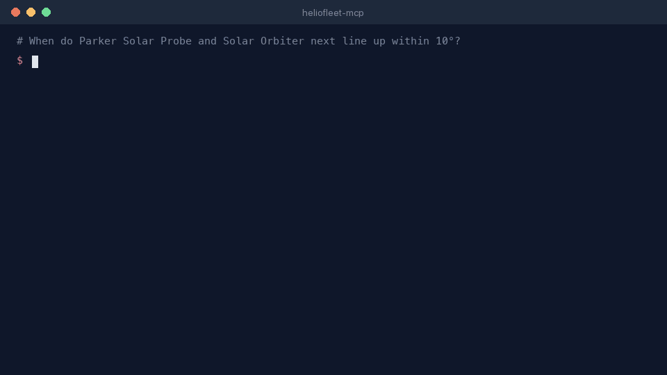

<div class="hf-hero" markdown>

# heliofleet-mcp

Where the heliophysics spacecraft are, what each sees of the Sun, when two of them line up, and
where each connects magnetically to the Sun, from JPL Horizons ephemerides and PFSS models.
Every answer comes with a link that opens the same moment on
[HelioFleet](https://sr-dash.github.io/heliofleet/) or [HelioField](https://sr-dash.github.io/heliofield/).

`uvx heliofleet-mcp`

[Get started](getting-started.md){ .md-button .md-button--primary }
[API reference](api/index.md){ .md-button }
[GitHub](https://github.com/sr-dash/heliofleet-mcp){ .md-button }

</div>

<div class="grid cards hf-cards" markdown>

-   :material-connection:{ .lg .middle } __MCP server__

    ---

    Fifteen tools for any Model Context Protocol client: positions, trajectories, alignments,
    viewing geometry, observation search, events, magnetic connectivity and links.

    [:octicons-arrow-right-24: MCP tools](tools.md)

-   :material-console:{ .lg .middle } __Command line__

    ---

    One question, one JSON answer, no set-up:
    `uvx heliofleet-mcp align psp solo --tol 10 --next`

    [:octicons-arrow-right-24: Commands](command-line.md)

-   :material-language-python:{ .lg .middle } __Python API__

    ---

    `from heliofleet_mcp import Fleet, HelioField` returns the same dictionaries as the tools.

    [:octicons-arrow-right-24: Python](python.md)

-   :material-check-decagram:{ .lg .middle } __Checked against SunPy__

    ---

    Stonyhurst and Carrington coordinates agree with SunPy and JPL Horizons to 0.0004°; alignment
    windows are identical to HelioFleet's own code.

    [:octicons-arrow-right-24: Methods and data](methods.md)

</div>

## One question, one answer

> When are Parker Solar Probe and Solar Orbiter next radially aligned within 10°?

<div class="hf-demo" markdown>

</div>

=== "Command line"

    ```bash
    uvx heliofleet-mcp align psp solo --tol 10 --after 2026-11-19 --next
    ```

=== "Python"

    ```python
    from heliofleet_mcp import Fleet

    Fleet().find_alignments("radial", "psp", "solo", 10, "2026-11-19", max_windows=1)
    ```

=== "MCP tool"

    ```text
    find_alignments(kind="radial", a="psp", b="solo", tolerance_deg=10,
                    start="2026-11-19", max_windows=1)
    ```

The window is 1 December 2026, 16:00 to 19:00 UTC, closest at 18:00 with the two spacecraft 6.2°
apart as seen from the Sun: Parker at 0.050 au on its perihelion pass and Solar Orbiter at 0.861 au.
JPL Horizons gives 6.18° at the same hour.
[Open it on HelioFleet :octicons-link-external-16:](https://sr-dash.github.io/heliofleet/?t=2026-12-01T18:00Z&align=radial,psp,solo,10,2026-11-19,2027-11-19&tab=align#tools)

## Spacecraft covered

SDO, SOHO, Aditya-L1, ACE, Wind, DSCOVR, IMAP, SOLAR-1 (SWFO-L1), Carruthers, Solar Orbiter,
Parker Solar Probe, BepiColombo, STEREO-A, STEREO-B, MAVEN, MESSENGER, Venus Express, Juno, Rosetta, JUICE,
Europa Clipper and Psyche, with Earth, Mercury, Venus and Mars,
from 2010 to about 2030. Ephemerides are refreshed monthly from JPL Horizons; HelioField's PFSS
products are daily.

## Where it is published

| | |
| --- | --- |
| :fontawesome-brands-python: PyPI | [`heliofleet-mcp`](https://pypi.org/project/heliofleet-mcp/) |
| :material-server-network: MCP Registry | [`io.github.sr-dash/heliofleet-mcp`](https://registry.modelcontextprotocol.io/v0/servers/io.github.sr-dash%2Fheliofleet-mcp/versions/latest) |
| :fontawesome-brands-github: Source | [github.com/sr-dash/heliofleet-mcp](https://github.com/sr-dash/heliofleet-mcp) |
| :material-archive: Zenodo | [doi:10.5281/zenodo.24409982](https://doi.org/10.5281/zenodo.24409982) |
